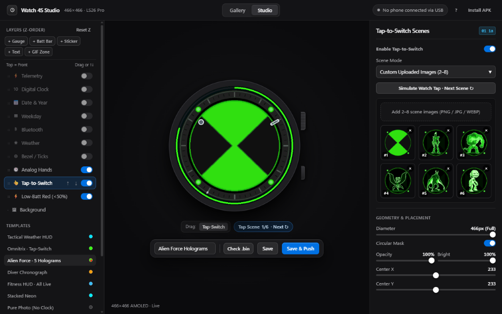

# Haylou Watch 4S — Watchface Studio & Companion App Patcher

[-0A84FF?style=flat-square)](docs/hardware_architecture.md)
[](docs/protocol_specs.md)
[-FFD60A?style=flat-square)](requirements.txt)
[](LICENSE)

An all-in-one, **point-and-click Watchface Studio** and **Haylou Fun companion app patcher** for the **Haylou Watch 4S** (`LS26` · `466×466` Round AMOLED).

- **Design custom watchfaces in your browser** — photos without a forced clock, custom fonts, analog hands, live weather/steps/HR/battery gauges, animated GIFs, tap-to-switch multi-scene dials (Ben 10 Omnitrix, Fallout Pip-Boy 3000, 16-Bit RPG Boss Battle, X-Ray Caseback Peeler), or imported Amazfit `.bin` dials.
- **Unlock & fix the Haylou Fun Android app** — enables hidden Watch 4S health cards, fixes cycling phantom steps & missing speed/HR charts, fixes Health Connect sleep sync crashes, adds night-only wrist-wake off, and rings your watch for WhatsApp/Messenger/Telegram/Discord/Instagram/Viber calls with working wrist reject.
- **100% safe & reversible** — never flashes watch firmware or bootloaders. Everything installs through the watch's official cloud watchface slot, and switching faces on the watch restores stock dials instantly.
- **No Java or Android Studio required** — runs purely on Python.




<details>
<summary><strong>View Watch Face Gallery Screenshot</strong></summary>


</details>

---

## Table of Contents

- [Easy Step-by-Step Setup Guide (For Beginners)](#easy-step-by-step-setup-guide-for-beginners)
- [What Watch 4S Studio Can Build](#what-watch-4s-studio-can-build)
- [What the Haylou Fun App Patcher Unlocks & Fixes](#what-the-haylou-fun-app-patcher-unlocks--fixes)
- [Command-Line Tools (Optional / Advanced)](#command-line-tools-optional--advanced)
- [Troubleshooting & FAQ](#troubleshooting--faq)
- [Documentation & Specs](#documentation--specs)
- [Project Layout](#project-layout)
- [Disclaimer & License](#disclaimer--license)

---

## Easy Step-by-Step Setup Guide (For Beginners)

You do **not** need Java, Android Studio, or coding experience. Everything can be done from a simple browser window.

### What You Need Before Starting

1. **A Windows, macOS, or Linux computer** with **[Python 3.9+](https://www.python.org/downloads/)** installed.
   - *Windows tip:* On the first screen of the Python installer, make sure you tick **"Add python.exe to PATH"**.
2. **An Android phone with USB Debugging enabled** (needed to send custom watchfaces from your PC to your phone):
   - Open phone **Settings → About phone → Software information**.
   - Tap **Build number** 7 times until it says *"Developer mode has been turned on"*.
   - Go back to **Settings → Developer options** and turn on **USB debugging**.
   - Install **Android Platform Tools (`adb`)** on your PC ([official Google download](https://developer.android.com/tools/releases/platform-tools)) and add it to your `PATH` (or place `adb.exe` where your system can find it).
3. **A copy of the official Haylou Fun `v4.0.8` APK file** *(not included in this repo for copyright reasons)*.
   - Download **Haylou Fun v4.0.8** from a trusted archive (e.g. APKMirror / APKPure) and save it in your `Downloads` folder as `haylou-fun-v4-0-8.apk` (or anywhere on your computer).

---

### Step 1 — Download & Install This Tool

Download this repository (green **Code → Download ZIP** button on GitHub, then unzip it), **or** run:

```bash
git clone https://github.com/toruu7/haylou-watch4s-watchface-maker.git
cd haylou-watch4s-watchface-maker
```

Open a terminal / Command Prompt inside the folder and install the two small Python packages (`Pillow` and `cryptography`):

```bash
pip install -r requirements.txt
```

---

### Step 2 — Launch Watch 4S Studio

- **Windows:** Double-click **`launch_studio.bat`**
- **macOS / Linux:** Run **`./launch_studio.sh`** (or `python3 studio/server.py`)

Your web browser will open **Watch 4S Studio** at **`http://127.0.0.1:8466`**.

---

### Step 3 — Patch & Install Haylou Fun (One-Time Setup)

You only need to do this once so Haylou Fun accepts your custom watchfaces and includes all Watch 4S health/smart fixes.

1. At the top of Watch 4S Studio, click the **`APK Patcher`** tab.
2. Click the upload box and pick your official **`haylou-fun-v4-0-8.apk`** (if it's already in your `Downloads` folder, Studio detects it automatically).
3. Leave all feature checkboxes ticked *(recommended)*, and optionally adjust the **Night Raise-to-Wake Off Window** (default `23:00-07:00` keeps your watch screen off while sleeping without muting calls or alarms).
4. Click **`Build & Sign Patched APK`** and wait ~30–60 seconds while Python patches and signs the app.
5. **Install the patched APK onto your phone** (choose either option):
   - **Option A — USB Cable (Fastest):** Plug your phone into your PC, unlock your phone, tap **Allow** on the *"Allow USB debugging?"* prompt, and click **`Install via USB (ADB)`**.
   - **Option B — Over Wi-Fi (No Cable):** Make sure your phone and PC are on the same Wi-Fi, click **`Start Wireless Download Server`**, open the link shown on your phone's browser, download the APK, and tap it to install.

> **First-time switch from Google Play Store:** Android won't let a self-signed APK overwrite the Play Store signature on the first install. Simply **uninstall** the Play Store version of Haylou Fun first, install the patched APK, and **log back into your Haylou account** — your cloud data restores automatically. All future patched updates install right on top without losing any data.
>
> **Very Important — Stop Play Store Auto-Updates:** Open **Google Play Store → search "Haylou Fun" → tap `⋮` (top right) → uncheck `Enable auto update`**. Otherwise Google Play will replace your patched app with the stock version later.

---

### Step 4 — Create & Send a Custom Watchface to Your Watch

1. Plug your phone into your PC over USB (keep the screen unlocked).
2. In Watch 4S Studio (**Designer** tab), either:
   - Pick one of the **14 built-in templates** in the left sidebar (like **Alien Force · 5 Holograms**, **Pip-Boy 3000 · 4 Themes**, **16-Bit RPG Boss Battle**, **X-Ray Caseback Peeler**, **Tactical Weather HUD**, **Diver Chronograph**, **Fitness HUD**, or **Pure Photo (No Clock)**), **or**
   - Upload your own photo, GIF, custom `.ttf`/`.otf` font, or even an Amazfit `.bin` watchface, and drag elements directly on the round preview.
3. Click **`Save & Push`** (or open the **Gallery** tab and click **`Push to Watch`**). Studio compiles your `.bin` file, checks that it fits safely inside the watch's `960 KB` limit, and copies it straight to your phone.
4. Now pick up your phone and open **Haylou Fun** (with your Watch 4S connected):
   - Go to **Device → Dial Center / Watch Face Market**.
   - Tap **any free cloud watchface** and tap **Sync / Install**.
   - Instead of that stock dial, the patched app streams **your custom watchface** straight to the Watch 4S!

---

## What Watch 4S Studio Can Build

| Category | What You Can Do |
| :--- | :--- |
| **Live Round Editor** | Pixel-exact `466×466` AMOLED preview, drag-and-drop layers, snap-to-center guides, arrow-key nudging (`Shift` for 1px), full back-to-front layer ordering, and automatic `960 KB` flash-budget validation. |
| **14 Built-In Templates** | Ready-to-use dials including **Alien Force · 5 Holograms** (green Omnitrix that automatically turns red below 50% battery with a color-matched ring + 5 tap-switch alien holograms + Silver Glass hands), **Pip-Boy 3000 · 4 Themes** (4 tap-switch CRT colorways with live gauges), **16-Bit RPG Boss Battle** (4 tap-switch pixel dungeon bosses with an inverted Boss HP bar that drains as you walk + animated knight + MP battery bar), **X-Ray Caseback Peeler** (tap to peel from Dark Titanium Dress → Open-Heart Mechanical Skeleton → CAD Blueprint → FLIR Thermal Scan with a live spinning tourbillon & power-reserve arc), **Tactical Weather HUD**, **Diver Chronograph**, **Fitness HUD**, **Stacked Neon**, **Pure Photo (No Clock)**, and 5 Omnitrix styles. |
| **Tap-to-Switch (`01 1a`)** | Tap your watch screen to cycle through 2–8 backgrounds or themes (including a **Simulate Watch Tap** button right in Studio). |
| **Animated GIF / WebP (`01 2e`)** | Full-screen animated loops or up to **3 floating GIF zones** at any layer depth, with automatic frame compression and duplicate-frame deduplication. |
| **Analog Hands (`01 0a`)** | Smooth 60Hz Hour/Minute/Second hands — 8 built-in packs (**Omnitrix**, **Omnitrix Silver Glass**, **Stark Arc Reactor**, **Skeleton Dauphine**, **8-Bit Pixel**, **Classic**, **Neon**, **Minimalist**) plus **Custom PNG hand & center-cap uploads**. |
| **Bezels, Clock, Date & Weather** | 8 procedural bezel styles, horizontal or stacked digital `HH:MM` with blinking colon, live seconds (`01 18`), AM/PM (`01 11`), custom `.ttf`/`.otf` fonts, weekday (`01 04`), date/year, 9-state weather icon (`01 1b`) + temperature (`01 1c`), and Bluetooth badge (`01 14`). |
| **Live Health & Battery Widgets** | Live Steps (`01 07`), Heart Rate BPM (`01 06` + `01 23` `--`), Calories (`01 09`), Distance (`01 08` + `km`/`mi`), Battery % (`01 15`), up to 4 stacked circular/bar gauges (`01 12`), and native clipped Battery Fill Bar (`01 05`). |
| **Import, Export & Share** | Save & duplicate presets, share single-file `.face.zip` bundles (all assets included), import raw Watch 4S `.bin` dials, or unpack **Amazfit UIHH `.bin`** watchfaces. |

---

## What the Haylou Fun App Patcher Unlocks & Fixes

All patches are applied locally to **Haylou Fun v4.0.8** using pure Python (`scripts/patch_and_build_apk.py`) and can be toggled individually in Studio's **APK Patcher** tab or via CLI flags. See [`docs/apk_patcher_guide.md`](docs/apk_patcher_guide.md) for deep technical details.

| Module (CLI Flag) | Plain-English Summary of What It Does |
| :--- | :--- |
| **Watchface Sideloading + FB Login Fix** (`--noclock`) | Lets you load custom watchfaces through Dial Center, hides the stock clock overlay on photo dials, fixes the watchface free-space check (prevents Error Code 3 on larger custom dials), and fixes Facebook login on self-signed builds. |
| **Hidden Watch 4S Health Cards** (`--unlock-cards`) | Unlocks hidden cards & watch settings that Watch 4S hardware supports: **Vitality/PAI**, **VO2 Max**, **HRV**, **Active/Standing Hours**, **High/Low Heart Rate Alerts**, and **Daytime Sleep Naps**. |
| **Resting Heart Rate Card** (`--rhr`) | Adds a 3rd **Resting Heart Rate** card inside Heart Rate Details (Day, Week, Month & Year tabs) calculated from your quietest sustained heart rate window. |
| **Vitality (PAI) & VO2 Max Engine** (`--vitality-vo2`) | Calculates daily **PAI Vitality Score** and **VO2 Max** directly on your phone from Watch 4S heart rate data (automatically backfills the last 30 days and updates live on sync). |
| **Workout Analytics, HR Stats & Speed Chart** (`--workout-analytics`) | Fills in the workout panels Watch 4S leaves blank: **Aerobic & Anaerobic Training Effect (`0.2–5.0`)**, **Training Load (EPOC)**, **Recovery Time**, **Per-Workout VO2 Max**, missing **Avg / Max / Min Heart Rate**, and a continuous **10-second GPS Speed Line Chart + Fastest Speed** (`speedList`) for cycling rides (30-day backfill + live before cloud upload). |
| **Health Connect Sleep Sync Fix** *(always included)* | Fixes a stock Haylou Fun crash (`startTime must be before endTime`) caused when Watch 4S sends a 0-minute sleep stage, so every night's sleep syncs reliably to Android Health Connect. |
| **HRV & Standing Hours** (`--hrv-active`) | Computes **30-minute HRV** from Watch 4S's 24/7 PPG Stress & quiet HR readings, and powers the **12-hour Active / Standing Hours** bar chart (30-day backfill + live sync). |
| **Hourly Charts (`BLE 0x59`)** (`--hourly-charts`) | Pulls Watch 4S's built-in 30-minute hardware step history and unhides the **Day (`D`) hourly bar charts** for Steps, Calories, and Exercise across Home and Daily Activities. |
| **Night Raise-to-Wake Off** (`--night-raise-to-wake`) | Unhides **Device Settings → DND mode** and wires it **only** to Watch 4S's wrist-wake schedule (default off `23:00–07:00`), so your watch screen won't light up in bed while calls and notifications still come through. |
| **Cycling Fixes** (`--cycling-fixes`) | Removes fake handlebar-vibration steps counted during bike rides (using exact 30-min overlap while keeping bike distance & calories), calculates true moving time & average speed on synced GPS rides without breaking GPS tracks for Strava, and adds live GPS auto-pause/auto-resume (`<3.6 km/h` / `>=5.4 km/h`) for phone-started rides. |
| **VoIP Call Alerts + Wrist Reject** (`--voip-calls`) | Rings your Watch 4S with the real caller's name for incoming **WhatsApp, WhatsApp Business, Messenger, Instagram, Telegram, Viber, and Discord** calls, stops ringing when answered/missed, and declines the call when you tap Reject on the watch. |

---

## Command-Line Tools (Optional / Advanced)

If you prefer the command line over the browser UI:

```bash
# 1. Patch Haylou Fun v4.0.8 with every module (recommended):
python scripts/patch_and_build_apk.py --src /path/to/haylou-fun-v4-0-8.apk --all

# Custom default Night Raise-to-Wake off hours (default is 23:00-07:00):
python scripts/patch_and_build_apk.py --src /path/to/haylou-fun-v4-0-8.apk --all --night-hours 22:30-06:30

# Watchface sideloading only (no health/BLE mods):
python scripts/patch_and_build_apk.py --src /path/to/haylou-fun-v4-0-8.apk --noclock

# Install patched APK via USB:
adb install -r haylou-fun-v4-0-8-full-health.apk
```

Standalone watchface CLI scripts:

```bash
# Pure 466x466 image (no clock, no date, no widgets) + push over USB:
python scripts/watchface_bin_maker.py "path/to/artwork.png" --push

# Custom digital clock + font + color + push over USB:
python scripts/watchface_bin_maker.py "path/to/artwork.png" \
  --with-clock --clock-pos 233 120 \
  --font "C:\Windows\Fonts\impact.ttf" --font-size 64 --font-color "#00FFCC" \
  --push

# Ben 10 Omnitrix generator (alien_force | os | omniverse | 5yl):
python scripts/omnitrix_watchface_maker.py --style alien_force --color green --push
python scripts/omnitrix_watchface_maker.py --style omniverse --hex "#00E5FF" --push
```

On Windows, you can also drag & drop any image straight onto **`make_and_push_noclock.bat`**.

---

## Troubleshooting & FAQ

- **Can this brick or damage my Watch 4S?**
  **No.** Custom dials only go into the watch's normal cloud watchface slot. Watch firmware and bootloaders are never touched. If you ever want to go back, just switch to any built-in watchface on the watch itself.
- **Phone says *"App not installed as package conflicts with an existing package"*?**
  That happens the first time you replace the Google Play Store version with your self-signed patched APK. Uninstall Play Store Haylou Fun first, install the patched APK, and sign back into your Haylou account. *(Keep the generated `keystore/debug.keystore` file safe so future rebuilds upgrade in-place without uninstalling!)*
- **Watchface sync fails at 0% with "Error Code 3"?**
  1. Click **Check `.bin`** in Studio and make sure the file is under **960 KB**.
  2. Make sure your phone is running the latest patched APK built from `scripts/patch_and_build_apk.py` (which fixes the watch free-space check when sideloading larger dials).
- **Phone is not detected when clicking *Save & Push* or *Install via USB*?**
  Make sure **USB Debugging** is enabled on your phone, the phone screen is **unlocked**, you tapped **Allow** on the USB debugging popup, and running `adb devices` in a terminal shows your phone as `device` (not `unauthorized`).
- **Google Play Store overwrote my patched Haylou Fun?**
  Open **Play Store → Haylou Fun → `⋮` → uncheck `Enable auto update`**, then reinstall your patched APK.
- **Why did my older Strava rides look blocky on the speed graph?**
  Strava on Android receives Watch 4S rides through **Haylou Cloud** (Strava does not read workout routes from Android Health Connect). Stock Watch 4S uploads omitted `speedList` and HR summary fields; rides synced **after** installing the latest patched APK now include both `speedList` (10-second GPS speed stream) and Avg/Max HR before Cloud upload.

---

## Documentation & Specs

| Document | Contents |
| :--- | :--- |
| [`docs/apk_patcher_guide.md`](docs/apk_patcher_guide.md) | Technical breakdown of every APK patcher module, pure-Python signing, wireless install, and safety notes |
| [`docs/protocol_specs.md`](docs/protocol_specs.md) | Complete LS26 `.bin` container spec (verified across 210+ official dials), opcodes (`01 00`–`01 2e`), and ARGB565-RLE codec |
| [`docs/hardware_architecture.md`](docs/hardware_architecture.md) | Haylou Watch 4S (`JL7012A7`) hardware teardown and comparison against Realtek-based models |
| [`docs/firmware_teardown.md`](docs/firmware_teardown.md) | Full `JL7012A7` OTA firmware reverse engineering: cracked SFC flash crypto, silicon BOM, 16 MB NOR partitions, 40-thread RTOS table, BLE GATT ATT DB, `FE EA` framing & hidden capabilities |
| [`docs/haylou_watch4s_customizer_guide.md`](docs/haylou_watch4s_customizer_guide.md) | End-to-end watchface customization workflow and zero-brick safety analysis |
| [`CHANGELOG.md`](CHANGELOG.md) | Release history |

---

## Project Layout

```text
haylou-watch4s-watchface-maker/
├── launch_studio.bat                  # Windows one-click launcher for Watch 4S Studio
├── launch_studio.sh                   # macOS / Linux launcher for Watch 4S Studio
├── make_and_push_noclock.bat          # Drag & drop image → pure-image .bin + USB push
├── requirements.txt                   # Pillow>=10.2.0,<12 · cryptography>=41.0.0
├── pyproject.toml                     # Project metadata
├── studio/
│   ├── server.py                      # Local HTTP API, .bin compiler, APK patcher & Wi-Fi server
│   ├── index.html                     # Multi-layer dark-mode Watch 4S Studio & APK Patcher UI
│   └── assets/
│       ├── alien_force_holograms/     # Built-in Alien Force · 5 Holograms artwork
│       ├── pipboy_3000/               # Built-in Pip-Boy 3000 · 4 Themes artwork
│       ├── rpg_boss_battle/           # Built-in 16-Bit RPG Boss Battle sprites & arenas
│       └── xray_caseback/             # Built-in X-Ray Caseback Peeler layers & tourbillon
├── scripts/
│   ├── watchface_compiler.py          # Unified multi-layer LS26 .bin compiler & preview engine
│   ├── watchface_bin_maker.py         # Standalone digital / pure-image .bin CLI & RLE encoder
│   ├── amazfit_unpacker.py            # Amazfit UIHH QuickLZ .bin watchface importer
│   ├── omnitrix_watchface_maker.py    # Ben 10 Omnitrix procedural generator
│   ├── watchface_image_prepper.py     # 466×466 cropper & round bezel previewer
│   ├── patch_and_build_apk.py         # Modular pure-Python Haylou Fun v4.0.8 APK patcher
│   ├── dex_patcher_lib.py             # Pure-Python DEX parser & Dalvik bytecode assembler
│   ├── apk_signer.py                  # Pure-Python 4-byte/4KB zipalign + v2/v3 APK signer
│   ├── jieli_fw_unpacker.py           # Pure-Python JL701N .ufw/SFC firmware decrypter & GATT inspector
│   └── install_to_phone.bat           # One-click ADB APK installer
├── tests/
│   └── test_watch4s.py                # Automated compiler, DEX/APK signer & security tests
├── docs/
│   ├── apk_patcher_guide.md
│   ├── firmware_teardown.md
│   ├── protocol_specs.md
│   ├── hardware_architecture.md
│   ├── haylou_watch4s_customizer_guide.md
│   └── screenshots/
└── samples/
```

---

## Disclaimer & License

This is an independent community project not affiliated with Dongguan Liesheng Electronic Co., Ltd. (Haylou). No proprietary APKs, firmware, or copyrighted assets are included in this repository. Ben 10 / Omnitrix and Fallout / Pip-Boy are trademarks of their respective owners and are referenced descriptively for fan-made dial templates only.

Licensed under the [MIT License](LICENSE).
