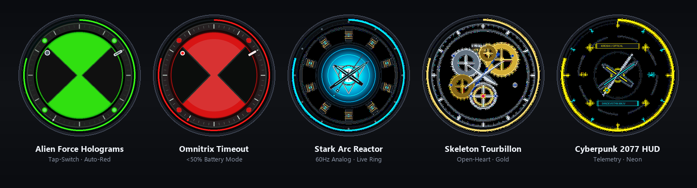
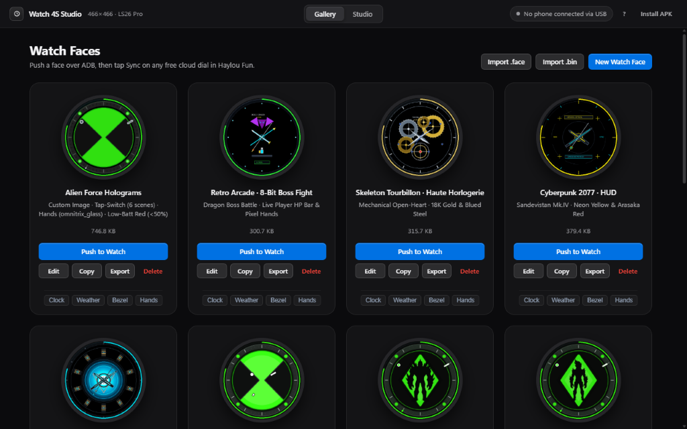

# Haylou Watch 4S Watchface Studio & Companion Patcher

[-0A84FF?style=flat-square)](docs/hardware_architecture.md)
[](docs/protocol_specs.md)
[-FFD60A?style=flat-square)](requirements.txt)
[](LICENSE)

An open-source **visual multi-layer watchface designer**, **native JieLi / MoYoung `.bin` compiler**, and **zero-Java pure-Python Haylou Fun APK patcher** for the **Haylou Watch 4S** (`LS26` / `02_A6` · JieLi `JL7012A7` · `466×466` Round AMOLED).

Overcomes the stock companion app's limitations—locked clock positions, fixed fonts, missing health analytics, phantom cycling steps, and silent VoIP calls—while staying **100% reversible and zero-brick safe** (never flashes watch firmware or bootloaders).




<details>
<summary><strong>View Watch Face Gallery Screenshot</strong></summary>



</details>

---

## Table of Contents

- [Watchface Studio Features](#watchface-studio-features)
- [Haylou Fun APK Patcher Modules](#haylou-fun-apk-patcher-modules)
- [Quick Start](#quick-start)
- [Command-Line Tools](#command-line-tools)
- [Documentation & Specs](#documentation--specs)
- [Project Layout](#project-layout)
- [Troubleshooting & FAQ](#troubleshooting--faq)

---

## Watchface Studio Features

| Category | Capabilities |
| :--- | :--- |
| **Visual Designer & Z-Order** | Local dark-mode browser UI (`http://127.0.0.1:8466`) with pixel-exact `466×466` AMOLED preview, drag-and-drop positioning, magnetic center guides, arrow-key nudging (`Shift` for 1px), back-to-front Z-order stack, and live `.bin` flash-budget checker (`960 KB` safe cap). |
| **Built-In Templates** | 7 ready-to-customize templates including **Alien Force · 5 Holograms** (auto-red `<50%` battery Omnitrix + color-matched ring + 5 tap-switch holograms + Silver Glass hands), **Tactical Weather HUD**, **Diver Chronograph**, **Fitness HUD**, **Stacked Neon**, and **Pure Photo (No Clock)**. |
| **Tap-to-Switch (`01 1a`)** | Tap the watch screen to cycle 2–8 interactive scenes (Day/Night gradients, Omnitrix colorways, or custom PNG/WebP uploads) with a built-in **Simulate Watch Tap** preview button. |
| **Animated GIF / WebP (`01 2e`)** | Full-screen animated backgrounds or up to **3 independent floating GIF zones** at any Z-order with RLE blob deduplication and automatic flash-budget fitting. |
| **Analog Hands (`01 0a`)** | 60Hz rotating Hour/Minute/Second hands — 8 procedural packs (**Omnitrix**, **Omnitrix Silver Glass**, **Stark Arc Reactor**, **Skeleton Dauphine**, **8-Bit Pixel**, **Classic**, **Neon**, **Minimalist**) plus **Custom PNG Hand & Center Cap uploads**. |
| **Procedural Bezels (`01 00`)** | 8 2×-supersampled bezel styles (Minimal Dots, Classic Baton, Diver Indices, Roman, Arabic, Tachymeter, Neon Rings, Radar HUD) with custom colors, inset, opacity, glow, and minute sub-ticks. |
| **Digital Clock, Date & Weather** | Horizontal or Stacked `HH:MM` (with native blinking colon), live Seconds (`01 18`), AM/PM (`01 11`), custom `.ttf`/`.otf` uploads, `MON DD`/`DD MON`/`YYYY` dates, 7-frame Weekday (`01 04`), 9-state Weather icon (`01 1b`) + Temperature (`01 1c`), and 2-state Bluetooth badge (`01 14`). |
| **Health Telemetry & Gauges** | Live Steps (`01 07`), Heart Rate BPM (`01 06` + `01 23` `--`), Calories (`01 09`), Distance (`01 08` + dynamic `01 1f` `km`/`mi`), Battery % (`01 15`), up to 4 stacked progress gauges (`01 12`), and native clipped Battery Fill Bar (`01 05`). |
| **Presets & Sharing** | Save, edit in-place, duplicate, export/import `.face.zip` bundles (with all assets), import raw `.bin` dials, and push to phone over USB ADB in one click. |

---

## Haylou Fun APK Patcher Modules

`scripts/patch_and_build_apk.py` patches **Haylou Fun v4.0.8** using **100% pure Python** (`dex_patcher_lib.py` + `apk_signer.py` with 4-byte/4KB alignment and APK Signature Scheme v2/v3 signing — **zero Java, `keytool`, `zipalign`, or Android SDK Build-Tools required**).

Full technical breakdown in [`docs/apk_patcher_guide.md`](docs/apk_patcher_guide.md).

| CLI Flag | Target DEX | What It Unlocks / Fixes |
| :--- | :--- | :--- |
| `--noclock` | `classes`, `3`, `6` | Suppresses photo-dial clock overlay (`0xB0`), bypasses Facebook SDK release signature check, and redirects cloud dial sideloading to `/sdcard/Android/data/com.yingsheng.hayloufun/cache/ls25plate.bin`. |
| `--unlock-cards` | `classes7` | Unlocks hidden Watch 4S cards & firmware-verified BLE controls: **Vitality/PAI**, **VO2 Max**, **HRV**, **Active/Standing Hours**, **High/Low HR Alert (`0x87 02`)**, and **Daytime Sleep Naps (`0xBC 01`)**. |
| `--rhr` | `classes7` | Adds a 3rd **Resting Heart Rate** card to Heart Rate Details (Day, Week, Month & Year tabs) computed from the lowest quiet HR window. |
| `--vitality-vo2` | `classes6` | On-device **Vitality Score (PAI)** & **VO2 Max** calculation engines (30-day backfill on launch + live update on BLE HR sync). |
| `--workout-analytics` | `classes6` | Computes **Aerobic & Anaerobic Training Effect (`0.2–5.0`)**, **Exercise Load (EPOC)**, **Recovery Time**, and **Per-Workout VO2 Max** in `SportDetailActivity`. |
| `--hrv-active` | `classes6`, `7` | **30-Minute Stress-Derived HRV** (`HrvTable`) and **Hourly Active / Standing Hours (12h)** engines with 30-day backfill + live refresh. |
| `--hourly-charts` | `classes3`, `5`, `6`, `7` | Unlocks Watch 4S's native **30-minute BLE `0x59` hardware step histograms** and unhides **Hourly Steps, Calories & Exercise Day (`D`) tabs** across Daily Activities and Home cards. |
| `--night-raise-to-wake` | `classes3`, `6`, `7` | Unhides **Device Settings → DND mode** and wires it exclusively to Watch 4S Raise-to-Wake (`BLE 0x72`, default `23:00–07:00` off) while keeping calls & notifications active at night. |
| `--cycling-fixes` | `classes6` | Strips phantom handlebar-vibration steps via exact `0x59` 30-min overlap, computes true moving time & moving avg speed on synced GPS rides (keeping GPS points intact for Strava), and adds live GPS auto-pause/auto-resume (`<3.6 km/h` / `>=5.4 km/h`). |
| `--voip-calls` | `classes6` | Rings Watch 4S with real caller names (`BLE 0x41`) for **WhatsApp, WhatsApp Business, Messenger, Instagram, Telegram, Viber, and Discord**, with working **wrist Reject**. |
| `--all` | All | Applies every module above in one command (default when no individual flags are passed). |

---

## Quick Start

### 1. Prerequisites
- **Python 3.9+** with `Pillow` and `cryptography` (`pip install -r requirements.txt`)
- **ADB (`adb`)** in your `PATH` (for USB pushing) + Android phone with **USB Debugging** enabled
- Your own copy of the official **Haylou Fun v4.0.8 APK** *(not redistributed in this repository)*

### 2. Clone & Install Dependencies
```bash
git clone https://github.com/toruu7/haylou-watch4s-watchface-maker.git
cd haylou-watch4s-watchface-maker
pip install -r requirements.txt
```

### 3. Patch & Install Haylou Fun (One-Time Setup)
```bash
# Full suite (recommended):
python scripts/patch_and_build_apk.py --src /path/to/haylou-fun-v4-0-8.apk --all

# Custom default Night Raise-to-Wake off window (default is 23:00-07:00):
python scripts/patch_and_build_apk.py --src /path/to/haylou-fun-v4-0-8.apk --all --night-hours 22:30-06:30

# Or install only watchface sideloading:
python scripts/patch_and_build_apk.py --src /path/to/haylou-fun-v4-0-8.apk --noclock
```

Install the generated APK via USB:
```bash
adb install -r haylou-fun-v4-0-8-full-health.apk
```
> **Important:** Open Google Play Store → **Haylou Fun** → **⋮** → uncheck **Enable auto update** so Play Store doesn't overwrite your patched build.

### 4. Launch Watch 4S Studio
- **Windows:** Double-click `launch_studio.bat`
- **macOS / Linux:** `./launch_studio.sh` (or `python3 studio/server.py`)

Studio opens at **http://127.0.0.1:8466** (override port with `STUDIO_PORT=8467`; enable request logging with `STUDIO_LOG=1`).

### 5. Push & Apply Any Watchface
1. In Studio, design a dial (or pick a template) and click **Save & Push** (or **Push to Watch** in Gallery).
2. Open **Haylou Fun** on your phone with Watch 4S connected.
3. Go to **Device → Dial Center / Watch Face Market**.
4. Tap **any free cloud watchface** and tap **Sync / Install**.
5. The patched app streams your custom `ls25plate.bin` directly into the watch's cloud dial slot.

---

## Command-Line Tools

```bash
# Pure 466x466 image (no clock, no date, no widgets) + ADB push:
python scripts/watchface_bin_maker.py "path/to/artwork.png" --push

# Custom digital clock + font + color + ADB push:
python scripts/watchface_bin_maker.py "path/to/artwork.png" \
  --with-clock --clock-pos 233 120 \
  --font "C:\Windows\Fonts\impact.ttf" --font-size 64 --font-color "#00FFCC" \
  --push

# Ben 10 Omnitrix generator (alien_force | os | omniverse | 5yl):
python scripts/omnitrix_watchface_maker.py --style alien_force --color green --push
python scripts/omnitrix_watchface_maker.py --style omniverse --hex "#00E5FF" --push
```

On Windows, you can also drag & drop any image onto `make_and_push_noclock.bat`.

---

## Documentation & Specs

| Document | Contents |
| :--- | :--- |
| [`docs/apk_patcher_guide.md`](docs/apk_patcher_guide.md) | Detailed breakdown of every APK patcher flag, pure-Python signing, wireless install, and safety notes |
| [`docs/protocol_specs.md`](docs/protocol_specs.md) | Complete LS26 `.bin` container spec (verified across 210+ official dials), every opcode (`01 00`–`01 2e`), and ARGB565-RLE codec |
| [`docs/hardware_architecture.md`](docs/hardware_architecture.md) | Haylou Watch 4S (`JL7012A7`) hardware teardown and comparison against Realtek-based models |
| [`docs/haylou_watch4s_customizer_guide.md`](docs/haylou_watch4s_customizer_guide.md) | End-to-end watchface customization workflow and zero-brick safety analysis |
| [`CHANGELOG.md`](CHANGELOG.md) | Release history (`v1.0.0` → `v2.0.0`) |

---

## Project Layout

```text
haylou-watch4s-watchface-maker/
├── launch_studio.bat                  # Windows launcher for Watch 4S Studio
├── launch_studio.sh                   # macOS / Linux launcher for Watch 4S Studio
├── make_and_push_noclock.bat          # Drag & drop image → pure-image .bin + ADB push
├── requirements.txt                   # Pillow>=10.2.0,<12 · cryptography>=41.0.0
├── pyproject.toml                     # Project metadata
├── studio/
│   ├── server.py                      # Local HTTP API, .bin compiler bridge & preset manager
│   ├── index.html                     # Multi-layer dark-mode Watch 4S Studio UI
│   └── assets/
│       └── alien_force_holograms/     # Built-in Alien Force · 5 Holograms template artwork
├── scripts/
│   ├── watchface_compiler.py          # Unified multi-layer LS26 .bin compiler & preview engine
│   ├── watchface_bin_maker.py         # Standalone digital / pure-image .bin CLI & RLE encoder
│   ├── omnitrix_watchface_maker.py    # Ben 10 Omnitrix procedural generator
│   ├── watchface_image_prepper.py     # 466×466 cropper & round bezel previewer
│   ├── patch_and_build_apk.py         # Modular pure-Python Haylou Fun v4.0.8 APK patcher
│   ├── dex_patcher_lib.py             # Pure-Python DEX parser & Dalvik bytecode assembler
│   ├── apk_signer.py                  # Pure-Python 4-byte/4KB zipalign + v2/v3 APK signer
│   └── install_to_phone.bat           # One-click ADB APK installer
├── docs/
│   ├── apk_patcher_guide.md
│   ├── protocol_specs.md
│   ├── hardware_architecture.md
│   ├── haylou_watch4s_customizer_guide.md
│   └── screenshots/
└── samples/
```

---

## Troubleshooting & FAQ

- **Can this brick my Watch 4S?**
  No. Custom dials are installed strictly into the watch's official cloud dial slot (`WacthFaceType.JIELI`). Firmware and bootloaders are never touched; switching watchfaces on the watch restores stock dials immediately.
- **Sync fails with Error Code 3?**
  Make sure your `.bin` is under the **960 KB** safe flash budget (use **Check `.bin`** in Studio) and that you are running the latest patched APK (`scripts/patch_and_build_apk.py`, which fixes the `ls25plate.bin` size check and `01 1a` dummy `DT#0` invariant).
- **Phone not detected by Studio?**
  Enable **USB Debugging** on Android, unlock the screen, accept the RSA fingerprint prompt, and verify `adb devices` lists your phone as `device`.
- **Play Store overwrote my patched Haylou Fun?**
  Disable **Enable auto update** on Haylou Fun's Play Store page and reinstall the patched APK.

---

## Disclaimer & License

This is an independent community project not affiliated with Dongguan Liesheng Electronic Co., Ltd. (Haylou). No proprietary APKs, firmware, or copyrighted assets are included in this repository. Ben 10 / Omnitrix and Fallout / Pip-Boy are trademarks of their respective owners and are referenced descriptively for fan-made dial templates only.

Licensed under the [MIT License](LICENSE).
