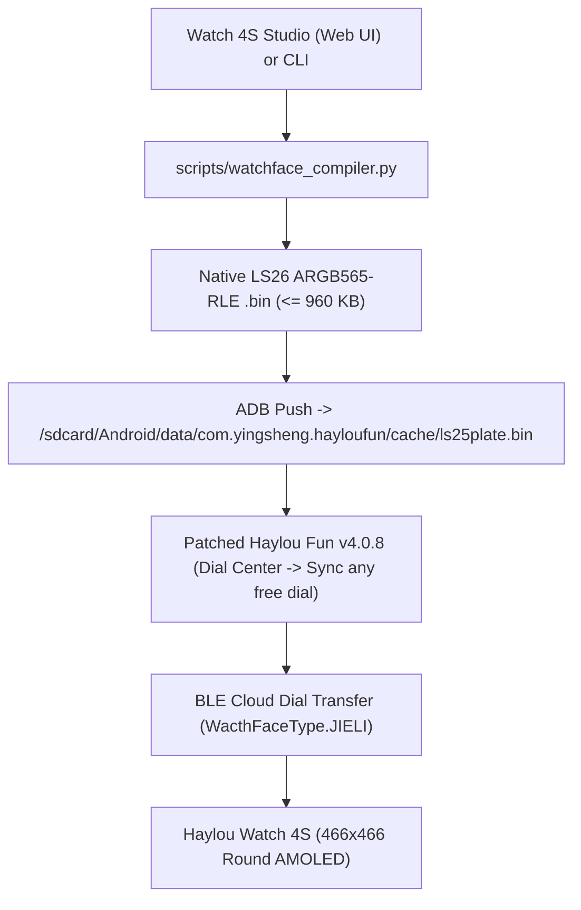

# Haylou Watch 4S (`LS26`) Custom Watchface & Companion Guide

This guide explains the reverse-engineered architecture, zero-brick safety guarantees, and step-by-step workflow for building custom watchfaces and patching **Haylou Fun v4.0.8** for the **Haylou Watch 4S** (`LS26` / `02_A6` · JieLi `JL7012A7`).

---

## 1. End-to-End Architecture



### Verified Hardware Specs
- **Model:** Haylou Watch 4S (`LS26`, Device Code `02_A6`, FCC `2AMQ6-HF012`)
- **MCU:** JieLi `JL7012A7` (`br28` / `AC701N`, 32-bit dual-core, 16 MB NOR Flash)
- **Display:** 1.43-inch Round AMOLED, `466×466` resolution, 60Hz
- **Protocol:** MoYoung / CRREPA BLE Protocol (`com.crrepa.ble`)

---

## 2. Zero-Brick Safety Guarantees

Because the Watch 4S uses a 2-pin magnetic charger (power only, no USB data), avoiding brick risk is critical:

> [!IMPORTANT]
> 1. **No Firmware or Bootloader Flashing:** Only user-space dial slots are written.
> 2. **Official Cloud Dial Channel:** Watchfaces transfer through the exact same `JIELI` cloud dial slot used by Haylou's own Watch Face Market.
> 3. **Hardware Watchdog Recovery:** If a `.bin` exceeds flash limits or is malformed, the watch rejects it during sync (e.g. Error Code 3) or falls back to the ROM default dial.
> 4. **100% Reversible:** Long-pressing the watch face or selecting any stock dial in Haylou Fun restores factory appearance immediately.

---

## 3. Step-by-Step Workflow

### Step 1: Patch & Install Haylou Fun v4.0.8
Run the pure-Python patcher (no Java or Android SDK Build-Tools required):
```bash
python scripts/patch_and_build_apk.py --src /path/to/haylou-fun-v4-0-8.apk --all
adb install -r haylou-fun-v4-0-8-full-health.apk
```
See [`docs/apk_patcher_guide.md`](apk_patcher_guide.md) for all modular flags (`--noclock`, `--unlock-cards`, `--rhr`, `--vitality-vo2`, `--workout-analytics`, `--hrv-active`, `--hourly-charts`, `--night-raise-to-wake`, `--cycling-fixes`, `--voip-calls`).

### Step 2: Launch Watch 4S Studio
- **Windows:** Double-click `launch_studio.bat`
- **macOS / Linux:** `./launch_studio.sh` (or `python3 studio/server.py`)

Open **http://127.0.0.1:8466** in your browser.

### Step 3: Design, Verify & Push
1. Start from a built-in template (such as **Alien Force · 5 Holograms**, **Tactical Weather HUD**, or **Diver Chronograph**) or upload your own `466×466` image / GIF / custom `.ttf` font.
2. Reorder layers in the **Z-Order Stack**, drag elements directly on the watch preview, and use **Simulate Watch Tap** for `01 1a` tap-switch scenes.
3. Click **Check `.bin`** to verify the compiled file stays under the `960 KB` flash budget.
4. Click **Save & Push** to send `ls25plate.bin` over ADB.
5. On your phone, open **Haylou Fun → Device → Dial Center**, tap **any free cloud watchface**, and hit **Sync / Install**.

---

## 4. Standalone CLI Tools

```bash
# Prep and preview a circular 466x466 image:
python scripts/watchface_image_prepper.py "path/to/image.jpg"

# Compile pure image (no clock) and push via ADB:
python scripts/watchface_bin_maker.py "path/to/image.png" --push

# Compile custom Omnitrix dial and push via ADB:
python scripts/omnitrix_watchface_maker.py --style alien_force --color green --push
```
