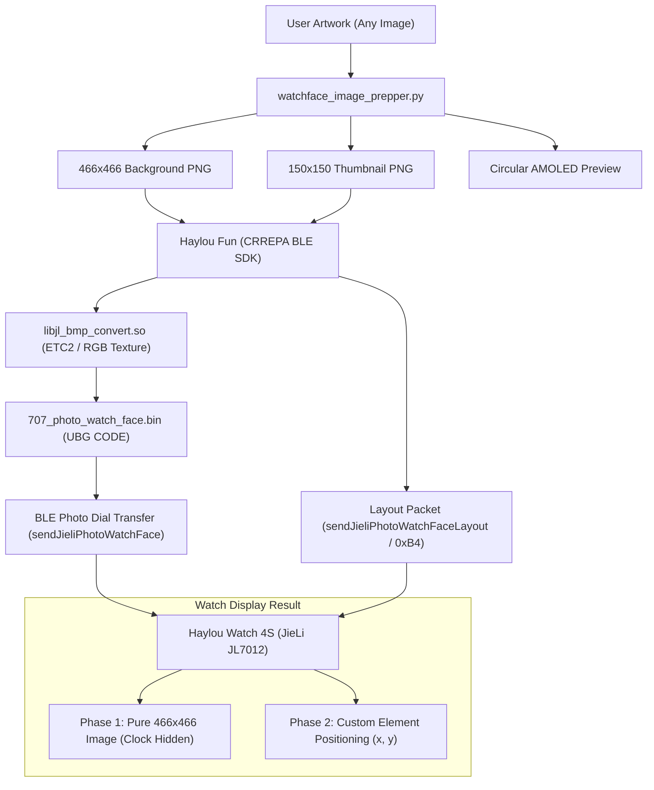

# Haylou Watch 4S (`LS26`) Custom Watchface & Clock Removal Guide

This document details the reverse-engineered architecture, protocol analysis, and concrete implementation steps for customizing watchfaces on the **Haylou Watch 4S** (Model: `LS26`, Device Code: `02_A6`, MCU: JieLi `JL7012A7`), with an emphasis on **zero-brick safety**.

---

## 1. Hardware & System Architecture



### Verified Hardware Specs
- **Model:** Haylou Watch 4S (`LS26`)
- **Factory ID / FCC:** `HF012` / `2AMQ6-HF012`
- **Device Code in APK:** `02_A6` (`Circle`, `466×466`)
- **Processor:** JieLi `JL7012A7` (`br28` / `AC701N` architecture, 32-bit dual-core, 16 MB NOR Flash)
- **Display:** 1.43-inch Round AMOLED, 466×466 resolution
- **Underlying Protocol:** MoYoung / CRREPA BLE Protocol (same family as Da Fit)

---

## 2. Safety Analysis: Why This Method Cannot Brick the Watch

Smartwatches like the Haylou Watch 4S use a 2-pin magnetic charging cable (power only, no USB data lines). Consequently, any risk of corruption would require a full device replacement under warranty. 

The mechanism established here guarantees **zero-brick safety** based on the following verified facts:

> [!IMPORTANT]
> 1. **No Firmware Partition Flashing:** We do not touch bootloaders, kernel partitions, or system code.
> 2. **Official Photo-Dial Channel:** We utilize the watch's official custom photo dial endpoint (`sendJieliPhotoWatchFace` and `sendJieliPhotoWatchFaceLayout`). The watch expects user-provided images here.
> 3. **Sandboxed Dial Slot:** The photo watchface occupies a dedicated user dial slot. If a dial image or layout packet is invalid or malformed, the JieLi MCU's watchdog simply reverts to the factory default dial in ROM.
> 4. **Completely Reversible:** Switching back to an official watchface in Haylou Fun immediately restores normal operation.

---

## 3. How Clock Removal Works (The Technical Mechanism)

Reverse engineering `haylou-fun-v4-0-8.apk` revealed that **the digital clock is never baked into the background image**. Instead:
1. The app uploads the background image (`707_photo_watch_face.bin`).
2. The watch firmware renders the clock and widgets on top of the image as dynamic software layers.
3. The layout packet dictates which elements are visible and their positions.

### Layout Encoders in CRREPA SDK

There are two layout encoders inside the APK:

#### A. Legacy Watchface Layout (Command `0xB0`, 52 bytes)
Generated by `com.crrepa.f.a2.a(CRPWatchFaceLayoutInfo)`:
- `Byte 0`: `0x11`
- `Byte 1`: `watchFaceStyle` (`0` = Top, `1` = Right-Top, `2` = Left-Top, `3` = Bottom, `5` = Analog Hands, `6` = Right-Bottom, `7` = Left-Bottom).
- `Bytes 2–5`: Widget styles.
- `Bytes 6–9`: Widget types (`0` = `WATCH_FACE_CONTENT_CLOSE`, which disables the widget).
- `Bytes 10–19`: RGB565 colors for pointers and elements.
- `Bytes 20–51`: 32-byte MD5 hash of the image.

#### B. JieLi Watchface Layout (Command `0xB4`, 30 bytes)
Generated by `com.crrepa.f.q2.a(CRPJieliWatchFaceLayoutInfo)`:
- `Byte 0`: `0x26` (Device Code / Command ID)
- `Byte 1`: `0x03`
- `Byte 2`: `watchFaceType`
- `Byte 3`: `showPointer` (`0` = No analog hands, `1` = Show analog hands)
- `Byte 4`: `photoDisplayMode` (`0`)
- `Byte 5`: `fixedPhotoIndex` (`0`)
- `Bytes 6–9`: `elementColor` (4 bytes ARGB)
- `Bytes 10–29`: Array of `ElementBean(type: byte, x: int, y: int)` (5 bytes per element, max 4 elements).

> [!TIP]
> **The Clock-Removal Key:** When `CRPJieliWatchFaceLayoutInfo` is sent with `showPointer = false` and an empty `elementArray`:
> - `showPointer` is `0` (no clock hands rendered).
> - `elementArray` has `0` elements (no digital time, date, or widgets rendered).
> - **Result:** The watch displays **only the pure 466x466 background image**.

---

## 4. Phase 1 Implementation Tools

### Tool 1: Image Prepper (`watchface_image_prepper.py`)
Located at: [watchface_image_prepper.py](file:///C:/Users/taron/.gemini/antigravity/brain/fd7146c8-d7dc-4e1e-bd97-ece4edbdfbe4/scratch/watchface_image_prepper.py)

#### Usage:
```powershell
python C:\Users\taron\.gemini\antigravity\brain\fd7146c8-d7dc-4e1e-bd97-ece4edbdfbe4\scratch\watchface_image_prepper.py "C:\path\to\your\image.jpg"
```
#### Output:
1. `<name>_466x466.png`: High-resolution background cropped to exact screen dimensions.
2. `<name>_round_preview.png`: Simulated round AMOLED bezel preview to evaluate how your image looks on the watch.
3. `<name>_thumb.png`: 150×150 thumbnail required by the dial synchronization protocol.

---

## 5. Execution Approaches for the User

We have prepared two execution routes:

### Route A: Modded Haylou Fun APK (Recommended for Everyday Use)
- **How it works:** A patched version of `haylou-fun-v4-0-8.apk` that intercepts `CrpDynamicWatchFace.sendDiyDial` and sends the zero-element layout.
- **Workflow:**
  1. Install the modded APK on your phone (no root needed).
  2. Open Haylou Fun -> Device -> Watch Faces -> Custom Dial.
  3. Pick any photo prepared by `watchface_image_prepper.py`.
  4. Select the "No Clock" toggle or style.
  5. Tap **Sync**. The watch face applies with pure artwork and no clock.

### Route B: ADB Companion / Wireless Script
- **How it works:** With USB Debugging or Wireless Debugging enabled, a Python/ADB script sends the layout packet directly to the watch through the app's running BLE service.
- **Workflow:**
  1. Enable USB Debugging on your phone.
  2. Connect phone to PC via USB (`adb devices`).
  3. Run the Python companion script to trigger the upload.

---

## 6. Phase 2 Roadmap: Element Coordinate Customization

Once the Phase 1 trial is confirmed on your physical watch:
1. **Arbitrary `(x, y)` Positioning:**
   - Modify `ElementBean(type, x, y)` to position the digital clock at any pixel offset (e.g., subtle bottom corner or top edge).
2. **Widget Selection:**
   - Selectively enable or disable individual widgets (battery, steps, heart rate).
3. **Official Cloud Watchface Customization:**
   - Download official `.bin` watchface packages from MoYoung CDN (`https://api.moyoung.com/faces/v3/list`).
   - Extract and replace background graphics while keeping the animations and fonts intact.
